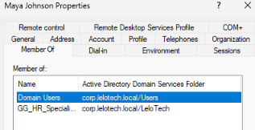
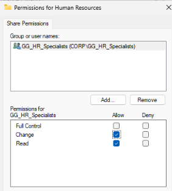
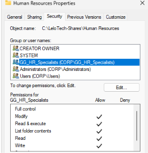

# Lab 01 — Active Directory Shared Folder Access Troubleshooting

## Overview

This lab simulates an IT Help Desk scenario involving an employee who reports difficulty accessing a shared department folder. The goal was to investigate Active Directory security group membership, NTFS permissions, network share permissions, and workstation connectivity to determine whether the employee had appropriate access.

## Lab Environment# Lab 01 — Active Directory Shared Folder Access Troubleshooting

## Overview

This lab simulates an IT Help Desk scenario involving an employee who reports difficulty accessing a shared department folder. The goal was to investigate Active Directory security group membership, NTFS permissions, network share permissions, and workstation connectivity to determine whether the employee had appropriate access.

## Lab Environment

- **Domain:** `corp.lelotech.local`
- **Domain Controller:** LeloTech-DC01 (Windows Server)
- **Client Workstation:** LeloTech-PC01 (Windows 11 Pro)
- **Domain Controller IP:** `192.168.50.10`
- **Network:** VirtualBox internal network (LeloTech-LAN)
- **Test Account:** Maya Johnson (`CORP\mjohnson`)
- **Security Group:** `HR_Specialists`
- **Shared Resource:** `\\192.168.50.10\HR`

## Reported Issue

An HR employee reported being unable to access the department's shared folder.

As the IT Support technician, my responsibility was to investigate the reported issue, verify the user's authorization, and test access from the employee's workstation without making unnecessary permission changes.

## Troubleshooting Process

### 1. Verified Active Directory Group Membership

Using Active Directory Users and Computers (ADUC), I located Maya Johnson's account and reviewed the **Member Of** tab.

I confirmed that Maya belonged to the `HR_Specialists` security group.

### 2. Inspected NTFS Permissions

On the domain controller, I navigated to `C:\Shares\HR` and inspected the folder's Security properties.

I confirmed that `HR_Specialists` had Modify, Read, Write, and other applicable permissions, excluding Full Control.

### 3. Inspected Network Share Permissions

I reviewed the folder's Advanced Sharing settings and confirmed that `HR_Specialists` had Change and Read permissions.

This helped verify that both NTFS and Share permissions allowed the employee to access and modify files over the network.

### 4. Tested Access from the Client Workstation

While signed in as Maya Johnson on

- **Domain:** `corp.lelotech.local`
- **Domain Controller:** LeloTech-DC01 (Windows Server)
- **Client Workstation:** LeloTech-PC01 (Windows 11 Pro)
- **Domain Controller IP:** `192.168.50.10`
- **Network:** VirtualBox internal network (LeloTech-LAN)
- **Test Account:** Maya Johnson (`CORP\mjohnson`)
- **Security Group:** `HR_Specialists`
- **Shared Resource:** `\\192.168.50.10\HR`

## Reported Issue

An HR employee reported being unable to access the department's shared folder.

As the IT Support technician, my responsibility was to investigate the reported issue, verify the user's authorization, and test access from the employee's workstation without making unnecessary permission changes.

## Troubleshooting Process

### 1. Verified Active Directory Group Membership

Using Active Directory Users and Computers (ADUC), I located Maya Johnson's account and reviewed the **Member Of** tab.

I confirmed that Maya belonged to the `HR_Specialists` security group.

### 2. Inspected NTFS Permissions

On the domain controller, I navigated to `C:\Shares\HR` and inspected the folder's Security properties.

I confirmed that `HR_Specialists` had Modify, Read, Write, and other applicable permissions, excluding Full Control.

### 3. Inspected Network Share Permissions# Lab 01 — Active Directory Shared Folder Access Troubleshooting

## Overview

This lab simulates an IT Help Desk scenario involving an employee who reports difficulty accessing a shared department folder. The goal was to investigate Active Directory security group membership, NTFS permissions, network share permissions, and workstation connectivity to determine whether the employee had appropriate access.

## Lab Environment

- **Domain:** `corp.lelotech.local`
- **Domain Controller:** LeloTech-DC01 (Windows Server)
- **Client Workstation:** LeloTech-PC01 (Windows 11 Pro)
- **Domain Controller IP:** `192.168.50.10`
- **Network:** VirtualBox internal network (LeloTech-LAN)
- **Test Account:** Maya Johnson (`CORP\mjohnson`)
- **Security Group:** `HR_Specialists`
- **Shared Resource:** `\\192.168.50.10\HR`

## Reported Issue

An HR employee reported being unable to access the department's shared folder.

As the IT Support technician, my responsibility was to investigate the reported issue, verify the user's authorization, and test access from the employee's workstation without making unnecessary permission changes.

## Troubleshooting Process

### 1. Verified Active Directory Group Membership

Using Active Directory Users and Computers (ADUC), I located Maya Johnson's account and reviewed the **Member Of** tab.

I confirmed that Maya belonged to the `HR_Specialists` security group.

### 2. Inspected NTFS Permissions

On the domain controller, I navigated to `C:\Shares\HR` and inspected the folder's Security properties.

I confirmed that `HR_Specialists` had Modify, Read, Write, and other applicable permissions, excluding Full Control.

### 3. Inspected Network Share Permissions

I reviewed the folder's Advanced Sharing settings and confirmed that `HR_Specialists` had Change and Read permissions.

This helped verify that both NTFS and Share permissions allowed the employee to access and modify files over the network.

### 4. Tested Access from the Client Workstation

While signed in as Maya Johnson on

I reviewed the folder's Advanced Sharing settings and confirmed that `HR_Specialists` had Change and Read permissions.

This helped verify that both NTFS and Share permissions allowed the employee to access and modify files over the network.

### 4. Tested Access from the Client Workstation

While signed in as Maya Johnson on